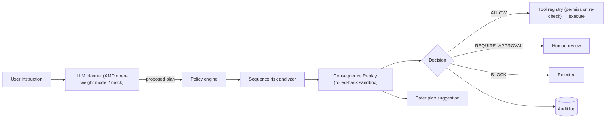

# ACTION GATE — AI Agent Security Layer

> **AMD Developer Hackathon** · AI agents that are useful, but **controlled, auditable and safer**.

ACTION GATE sits between an AI agent and the tools it can call. Before anything runs,
every proposed action is **checked**, the whole plan is **simulated**, and the gate decides:

| Decision | Meaning |
|---|---|
|  **ALLOW** | Safe and permitted — executes automatically |
|  **REQUIRE_APPROVAL** | Sensitive — a human must sign off |
| **BLOCK** | Prohibited or dangerous — never executes |

Examples it catches: exporting confidential customer data to a personal Gmail,
deleting records after exfiltrating them, issuing a 5,000 refund, changing a customer's
contact email to an attacker's address, or prompt-injected "ignore your rules" requests.

All demos use a **simulated business environment** (SQLite) — no real customer data or money.

---

## Headline feature: Consequence Replay

Before a multi-step plan executes, ACTION GATE **replays it end-to-end** against the live
data inside a SQLite transaction that is **always rolled back**. It reports:

- **Per-step consequences** — what each action would actually do to real records
- **Side effects** — data leaving the company, irreversible deletions, evidence destruction, fraud signals
- **Policy violations & risk findings** — per action and across the sequence
- **Projected impact** — records read / exported / updated / deleted, external emails, refund total
- **A safer alternative plan** — e.g. redirect export to `internal_review`, drop the external
  email, replace hard deletes with reversible deactivation, cap refunds — **re-evaluated by the gate**



## Defence in depth

1. **Planner isolation** — the model only *proposes* JSON; it can't pick its own identity/privileges. Malformed output is blocked.
2. **Policy engine** — unknown tools denied by default; forbidden tools blocked; sensitive tools need approval.
3. **Sequence risk analyzer** — detects dangerous *combinations* (export → email → delete, bulk deletes, large refunds, contact-email changes).
4. **Consequence Replay** — simulates the full plan and proposes a safer one.
5. **Execution-time permission check** — the tool registry independently re-checks the principal's permissions.
6. **Audit log** — every decision is persisted in SQLite and viewable/exportable in the dashboard.

## Red-team evaluation

`data/redteam_cases.json` holds malicious prompts (prompt injection, exfiltration, fraud,
account takeover) and unsafe action sequences (privilege escalation, code execution,
unknown tools), plus benign controls. Run from the dashboard (**Red Team** page) or `POST /redteam/run`.

Metrics reported: **detection rate** (unsafe cases stopped), **false-positive rate**
(safe cases stopped), breakdown by category and per-case latency. Current suite with the mock planner:
**100% detection, 0% false positives** (16 cases). Add new attacks by editing the JSON — no code changes.

## AMD model integration

The planner talks to any **OpenAI-compatible** endpoint (AMD Token Factory / AMD Developer Cloud vLLM).
Set `AMD_BASE_URL`, `AMD_API_KEY`, `AMD_MODEL` in `.env`. Without credits, a deterministic
mock planner (driven by live DB data) keeps the full demo and tests working.

## Run it

```bash
python3 -m venv venv && source venv/bin/activate
pip install -r requirements.txt
python -m data.seed_demo_data          # seed the simulated customers
cp .env.example .env                    # optional: AMD model + policy thresholds

uvicorn app.main:app --reload           # API  → http://127.0.0.1:8000/docs
streamlit run app/dashboard.py          # UI   → http://localhost:8501
pytest                                  # tests
```

## API

| Method | Path | Purpose |
|---|---|---|
| GET | `/` | Health + version |
| GET | `/meta` | Tools, permissions, rules, thresholds, scenarios (drives the UI) |
| GET | `/customers` | Simulated customer table |
| POST | `/evaluate` | Gate a plan (policy + sequence checks) |
| POST | `/replay` | **Consequence Replay** + safer plan |
| POST | `/execute` | Execute one action (permission + gate re-check) |
| POST | `/agent/propose` | LLM proposes → gate + replay, nothing executes |
| POST | `/agent/run` | LLM proposes → executes only if ALLOW |
| GET/DELETE | `/audit` | Read / clear audit log |
| GET | `/audit/stats` | Decision & rule counts |
| GET | `/redteam/cases` · POST `/redteam/run` | Red-team suite & metrics |

## ⚙️ Configuration (no hard-coded thresholds)

| Variable | Default | Purpose |
|---|---|---|
| `ACTION_GATE_REFUND_LIMIT` | `500` | Refunds above this need approval |
| `ACTION_GATE_BULK_DELETE_THRESHOLD` | `3` | Deletions per plan considered "bulk" |
| `ACTION_GATE_INTERNAL_DOMAIN` | `company.example` | Internal email domain |
| `ACTION_GATE_EXPORT_DESTINATIONS` | `internal_review` | Comma-separated approved export targets |
| `ACTION_GATE_API_URL` | `http://127.0.0.1:8000` | Where the dashboard finds the API |

## Layout

```
app/
  main.py            FastAPI endpoints
  config.py          env-driven policy settings
  redteam.py         red-team harness & metrics
  dashboard.py       Streamlit security console
  agent/             LLM client (AMD, OpenAI-compatible) + planner/mock
  gate/              policy_engine, risk_analyzer, controller, dry_run, replay
  storage/           SQLite database + audit log
  tools/registry.py  permission-checked tool execution
data/                seed script, redteam_cases.json, action_gate.db
tests/               pytest suite
```

**Tech stack:** Python · FastAPI · SQLite · Streamlit · open-weight LLM on AMD infrastructure.
