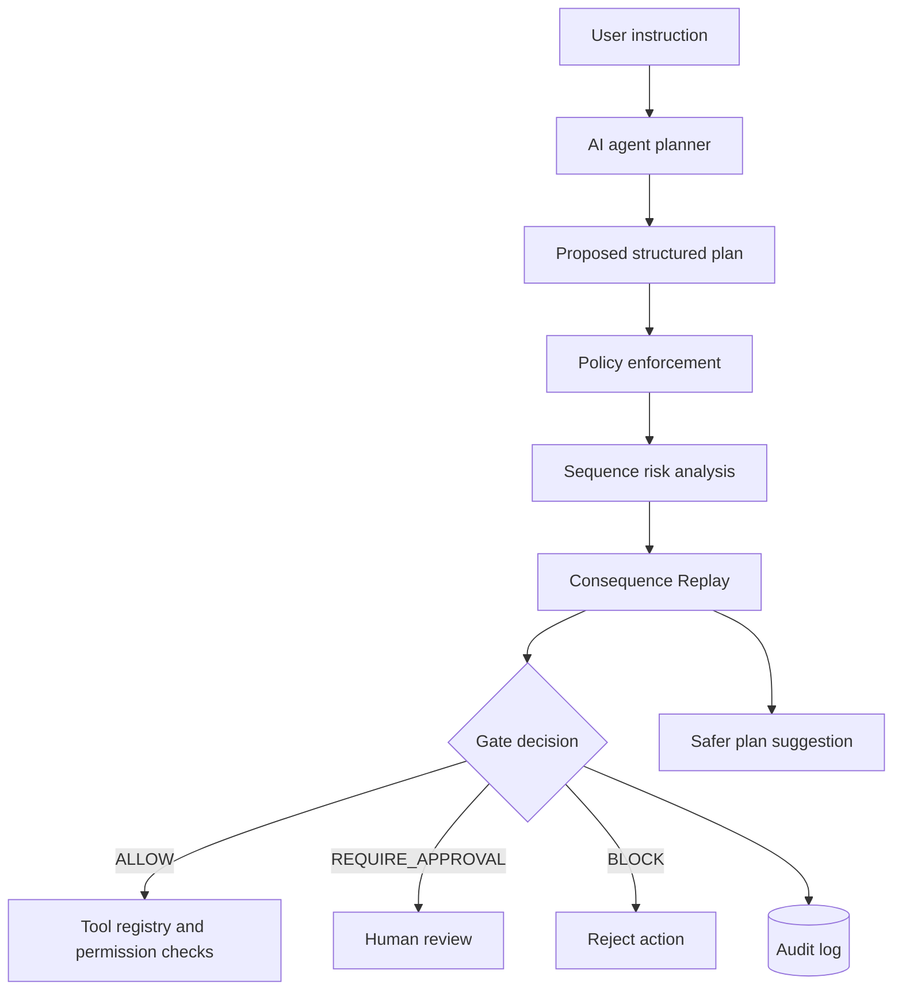

# ACTION GATE — AI Agent Security Layer

> **AMD Developer Hackathon Project** · A security gateway that makes AI agent actions controlled, auditable, and safer.

## Overview

ACTION GATE is a security layer between an AI agent and the tools it can use. Instead of allowing an agent to execute actions directly, the system evaluates its proposed plan, checks security policies, analyzes risks across multiple actions, and simulates potential consequences before execution.

Every plan receives one of three decisions:

| Decision | Meaning |
|---|---|
| `ALLOW` | The action is permitted under the configured policies. |
| `REQUIRE_APPROVAL` | A human must review and approve the sensitive action. |
| `BLOCK` | The action is prohibited or considered too dangerous to proceed. |

ACTION GATE is designed to identify scenarios such as unauthorized customer-data exports, bulk deletions, suspicious contact-email changes, excessive refunds, and prompt-injection attempts.

All demonstrations use a **simulated business environment backed by SQLite**. No real customer data or money is involved.

## Key Features

### 1. Policy Enforcement

- Validates proposed tool calls against configured security policies.
- Detects sensitive and prohibited actions.
- Applies authorization checks before tool execution.
- Separates permitted actions from those requiring approval or being blocked.

### 2. Consequence Replay

Before execution, ACTION GATE simulates a proposed plan against the business database inside a transaction that is rolled back.

The replay helps reveal what a plan could do before allowing it to proceed.

It reports:

- **Per-step consequences:** What each action could do to individual records.
- **Potential side effects:** Data exports, deletions, updates, emails, and refunds.
- **Policy violations:** Security findings for individual actions and across a sequence.
- **Projected impact:** Records read, exported, updated, or deleted, along with other relevant effects.
- **Safer alternatives:** Suggestions such as redirecting exports internally, replacing permanent deletion with reversible deactivation, or limiting refunds.

Suggested alternatives are evaluated by the gate again rather than being trusted automatically.

### 3. Sequence Risk Analysis

Individual actions can look harmless in isolation but become dangerous when combined. ACTION GATE analyzes the proposed sequence to identify risks such as combining data extraction with deletion or other suspicious operations.

### 4. Human Approval

Sensitive actions can be routed for human review rather than executed automatically. A safer suggested plan does not automatically bypass the approval requirement.

### 5. Audit Logging

The audit trail records decisions, findings, and execution-related information to support investigation and review.

### 6. Interactive Security Dashboard

The Streamlit dashboard provides a visual interface for exploring proposed actions, reviewing gate decisions, and understanding potential consequences.

### 7. Red-Team Evaluation

The project includes a predefined suite of 16 security test cases covering scenarios such as prompt injection, unauthorized exports, bulk deletion, and malformed or prohibited actions.

**Recorded project result:** 16 out of 16 test cases detected, with zero false positives in that suite. These results apply only to the project's predefined tests and are not an independent security audit or a guarantee against all attacks.

## Architecture



The core principle is simple:

**AI proposes actions. ACTION GATE evaluates and controls them.**

## Technology Stack

- **Python** — application and security logic
- **FastAPI** — backend API
- **Streamlit** — interactive dashboard
- **SQLite** — simulated business data and audit storage
- **Pytest** — automated testing
- **AMD-compatible model integration** — optional planner integration with a compatible model endpoint

## Current Project Status

ACTION GATE supports mock-planner mode and optional AMD-compatible model configuration.

The current verified setup uses **mock mode** because a live AMD model connection has not yet been successfully configured. Mock mode allows the security workflow, gate decisions, and demonstration scenarios to be tested without a live model.

A working model endpoint and valid credentials are required to demonstrate live model-generated plans. Model availability should be verified separately from the gate's security tests.

## Getting Started — Windows

### Prerequisites

- Python installed and available in PowerShell
- Git
- VS Code (recommended)

### 1. Clone the Repository

```powershell
git clone https://github.com/nimrafaryal/action-gate.git
cd action-gate
```

If you already have the repository, open the existing project directory instead.

### 2. Create and Activate a Virtual Environment

```powershell
python -m venv .venv
.\.venv\Scripts\Activate.ps1
```

If PowerShell blocks activation for the current terminal session, run:

```powershell
Set-ExecutionPolicy -Scope Process -ExecutionPolicy RemoteSigned
.\.venv\Scripts\Activate.ps1
```

### 3. Install Dependencies

```powershell
python -m pip install -r requirements.txt
```

### 4. Configure Environment Variables

Create a local `.env` file from the example:

```powershell
Copy-Item .env.example .env
```

Edit `.env` only if you need to configure optional settings. Use the variable names provided in `.env.example`.

For AMD-compatible model integration, the configuration may include:

- `AMD_BASE_URL`
- `AMD_API_KEY`
- `AMD_MODEL`

Use the actual endpoint, model identifier, and credentials provided by your model provider. Never commit API keys or other secrets to GitHub.

If the model is not configured, use the supported mock mode.

### 5. Prepare Demo Data

If you need to initialize the demo database, run:

```powershell
python -m data.seed_demo_data
```

Avoid rerunning the seeding script against a database containing data you want to preserve unless you have verified its behavior.

### 6. Start the Backend

In the first terminal, run:

```powershell
uvicorn app.main:app --reload
```

The API should be available at:

- **API base URL:** http://127.0.0.1:8000
- **Interactive API documentation:** http://127.0.0.1:8000/docs

Keep this terminal running.

### 7. Start the Dashboard

Open a second terminal in the project directory. Activate the virtual environment if needed, then run:

```powershell
.\.venv\Scripts\Activate.ps1
streamlit run app/dashboard.py
```

Open the local URL displayed by Streamlit, normally:

http://localhost:8501

Keep both the backend and dashboard running while using the application.

## API Reference

The application exposes the following routes.

| Method | Endpoint | Purpose |
|---|---|---|
| `GET` | `/` | Root endpoint |
| `GET` | `/meta` | Application metadata |
| `GET` | `/customers` | Retrieve demo customer data |
| `POST` | `/evaluate` | Evaluate a proposed plan |
| `POST` | `/replay` | Simulate plan consequences |
| `POST` | `/execute` | Execute a supported, authorized plan |
| `GET` | `/audit` | Inspect audit records |
| `GET` | `/audit/stats` | Review audit statistics |
| `DELETE` | `/audit` | Delete audit records |
| `GET` | `/redteam/cases` | List predefined red-team cases |
| `POST` | `/redteam/run` | Run the red-team evaluation |
| `GET` | `/agent/status` | Inspect agent and planner status |
| `POST` | `/agent/propose` | Generate and evaluate a proposal without executing it |
| `POST` | `/agent/run` | Run the configured agent workflow |

Visit `/docs` for the exact request schemas, response formats, and supported parameters.

**Safety note:** Use proposal and evaluation endpoints for safe demonstrations. Execution and audit-deletion endpoints can have effects on the local application state, so use them only when you understand their behavior.

## Run the Tests

With the virtual environment activated, run:

```powershell
python -m pytest -q
```

The last recorded result was **39 tests passed**. Run the test suite again after making changes to verify the current result.

To run the predefined red-team evaluation, use `/redteam/run` through the interactive API documentation or another supported request method.

## Repository Structure

```text
action-gate/
├── app/
│   ├── agent/       # Agent planning and workflow
│   ├── gate/        # Security decisions and risk analysis
│   ├── tools/       # Simulated business tools
│   ├── storage/     # Persistence and audit support
│   ├── evaluation/  # Security evaluation
│   ├── main.py      # FastAPI application
│   └── dashboard.py # Streamlit dashboard
├── data/            # Demo data setup
├── demo/            # Demonstration resources
├── tests/           # Automated tests
├── .env.example     # Example configuration
├── .gitignore
├── requirements.txt
└── README.md
```

## Security Scope and Limitations

ACTION GATE is a prototype demonstrating policy enforcement, risk analysis, consequence simulation, and auditability for AI-agent workflows.

- The business environment uses simulated data.
- Red-team results apply to the predefined test suite only.
- Mock-planner results do not establish the reliability of a live LLM.
- A suggested safer plan is not automatically authorized.
- Consequence Replay is a simulation, not a substitute for production isolation or independent security verification.
- Production deployment would require further security testing, authentication, access control, robust approval workflows, monitoring, and hardening of execution boundaries.

## Project Goal

ACTION GATE explores a practical approach to AI-agent security: inspect proposed actions, simulate their consequences, enforce policy, and maintain an auditable record before allowing sensitive operations.

**The goal is not to make AI agents less capable. It is to make their actions more accountable and controlled.**
